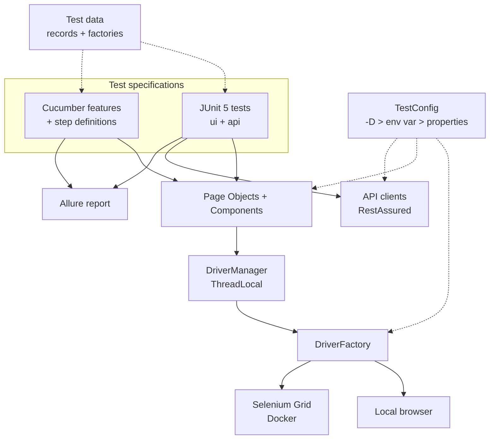

# Selenium Java Test Automation

[](https://github.com/ricardho/selenium-java-test-automation/actions/workflows/tests.yml)
[](https://ricardho.github.io/selenium-java-test-automation/)


Test automation framework covering **web UI**, **REST API** and **BDD** scenarios, built with
the tools most used in the market and current best practices for test architecture.

**Live test report:** https://ricardho.github.io/selenium-java-test-automation/

## Systems under test

| Layer | Application |
|---|---|
| Web UI | [Swag Labs](https://www.saucedemo.com), a demo e-commerce site |
| REST API | [Restful Booker](https://restful-booker.herokuapp.com/apidoc/index.html), a demo booking API |

## Tech stack

| Purpose | Tool |
|---|---|
| Language / build | Java 21, Maven |
| UI automation | Selenium WebDriver 4 (Selenium Manager, no manual drivers) |
| Test runner | JUnit 5 (tags, parameterized tests, parallel execution) |
| BDD | Cucumber 7 + Gherkin, PicoContainer for dependency injection |
| API testing | RestAssured + JSON Schema validation |
| Assertions | AssertJ (including soft assertions) |
| Test data | Datafaker |
| Reports | Allure (screenshots, page source and HTTP traffic attached) |
| Evidence | Configurable screenshots per step + PDF evidence per test (OpenPDF) |
| Infrastructure | Selenium Grid on Docker Compose |
| CI/CD | GitHub Actions, report published to GitHub Pages |

## Architecture



```
src/test/java/com/automation
├── config/        TestConfig: one place to read settings (system prop → env var → file → default)
├── driver/        DriverFactory (local/Grid, Chrome/Firefox/Edge) + DriverManager (ThreadLocal)
├── pages/         Page Objects with a fluent API
│   └── components/  Reusable UI parts (header, cart badge, menu)
├── data/          Records (User, Customer), enums (Product, SortOption) and data factories
├── api/           BookingClient + API models
├── support/       JUnit browser lifecycle extension, helpers
│   └── evidence/    Evidence modes, per-test recorder, PDF writer, step and HTTP capture
├── tests/ui/      UI tests (JUnit 5)
├── tests/api/     API tests (JUnit 5)
└── bdd/           Cucumber runner, hooks, shared scenario state and step definitions
src/test/resources
├── features/      Gherkin scenarios
├── schemas/       JSON schemas for contract validation
└── config.properties, junit-platform.properties
```

## Design decisions

- **Page Object Model with a fluent API.** Each action returns the next page
  (`login.loginAs(user).addToCart(p).goToCart().checkout()`), so tests read like the user journey.
  Assertions live only in tests and steps, never in page objects.
- **Pages verify they are loaded.** Each page waits for its own title when it is created, so a wrong
  navigation fails right away with a clear message.
- **Explicit waits only.** All interactions go through `WebDriverWait` in `BaseComponent`.
  No `Thread.sleep`, no implicit waits.
- **Stable locators.** `data-test` attributes first, then ids. No absolute XPath.
- **Independent tests.** Every test or scenario gets a fresh browser and creates its own data,
  so tests can run in any order and in parallel.
- **Thread-safe drivers.** `ThreadLocal` WebDriver enables parallel execution in both JUnit and Cucumber.
- **Externalized configuration.** URLs, browser, timeouts and credentials come from system properties
  or environment variables, with sensible defaults. Nothing environment-specific is hard-coded.
- **Generated test data.** Datafaker creates unique customers and bookings, avoiding collisions.
- **Configurable test evidence.** From failure-only screenshots up to a screenshot per step, plus
  one PDF evidence document per test, ready for audit or UAT sign-off (see [Test evidence](#test-evidence)).
- **API layer behind a client.** Tests never build raw HTTP calls, and responses are validated against JSON schemas.
- **No duplicated reporting.** JUnit and Cucumber run in separate Surefire executions, each with its own Allure adapter.

## Test coverage

| Area | Scenarios |
|---|---|
| Login | valid login, locked user, wrong password, required fields, logout |
| Inventory | sort by price and name, cart badge when adding/removing |
| Checkout | full purchase, order total and tax calculation, required customer fields |
| Booking API | create, get with schema validation, update, delete, invalid token, invalid credentials |
| BDD | login and checkout journeys written in Gherkin |

Tags: `ui`, `api`, `smoke`, `bdd`.

## Running the tests

**Prerequisites:** JDK 21+, Maven 3.9+, Chrome and/or Firefox. Docker is only needed for the Grid.

**First run:** create your local secrets file from the template and fill in the values
(where to find each one is described in the file):

```bash
cp .env.example .env      # Windows: copy .env.example .env
```

```bash
# Everything (JUnit + Cucumber)
mvn test

# JUnit tests only, or Cucumber only
mvn test -DskipBdd
mvn test -DskipJunit

# By tag
mvn test -DskipBdd -Dgroups=smoke
mvn test -DskipBdd -Dgroups=api
mvn test -DskipJunit -Dcucumber.filter.tags="@smoke"

# A single class
mvn test -DskipBdd -Dtest=CheckoutTest

# Other browsers, headless mode
mvn test -Dbrowser=firefox -Dheadless=true
```

> **Windows PowerShell:** wrap arguments that contain dots in quotes,
> e.g. `mvn test "-Dmaven.test.failure.ignore=true"`, otherwise PowerShell splits them.

> If the JUnit execution fails, Maven stops before running Cucumber.
> Add `-Dmaven.test.failure.ignore=true` to run both and inspect all failures in the report.

### Selenium Grid (Docker)

```bash
docker compose up -d
mvn test -Dgrid.url=http://localhost:4444 -Dbrowser=firefox
docker compose down
```

Grid console: http://localhost:4444/ui

### Configuration

Each setting is resolved in this order:
`-Dkey=value` → environment variable → local `.env` → `config.properties` → default.
See [.env.example](.env.example) for all variables.

| Property | Env var | Default |
|---|---|---|
| `base.url` | `BASE_URL` | https://www.saucedemo.com |
| `api.base.url` | `API_BASE_URL` | https://restful-booker.herokuapp.com |
| `browser` | `BROWSER` | chrome |
| `headless` | `HEADLESS` | false |
| `timeout.seconds` | `TIMEOUT_SECONDS` | 10 |
| `grid.url` | `GRID_URL` | (empty: run locally) |
| `evidence.mode` | `EVIDENCE_MODE` | failure (`failure`, `always`, `steps`) |
| `evidence.pdf` | `EVIDENCE_PDF` | true |
| `sauce.password` | `SAUCE_PASSWORD` | **secret**, no default |
| `api.username` / `api.password` | `API_USERNAME` / `API_PASSWORD` | **secret**, no default |

## Secrets management

Credentials are never stored in versioned files, following the [12-Factor](https://12factor.net/config) approach:
the code only reads environment variables and does not care where they come from.

| Environment | Source of secrets |
|---|---|
| Developer machine | `.env` file, git-ignored, created from `.env.example` |
| CI (GitHub Actions) | Repository secrets, exposed to the test jobs as environment variables and masked in logs |
| Larger organizations (next step) | A secrets manager such as HashiCorp Vault, AWS Secrets Manager or Azure Key Vault, injected by the pipeline |

Additional safeguards:
- **Gitleaks** scans the full git history on every push and fails the pipeline if a secret is committed.
- Feature files use the `${SAUCE_PASSWORD}` placeholder, resolved at runtime, so no password is written in Gherkin.
- `User.toString()` hides passwords, so they never appear in logs or Allure reports.
- Authentication requests bypass the raw AllureRestAssured log: passwords and tokens are masked
  as `***` in both the Allure report and the PDF evidence.
- A missing secret fails fast with a message explaining how to provide it.

> The credentials of both demo sites are public. They are still handled as secrets on purpose,
> to demonstrate the approach used in real projects.

## Test evidence

Many teams (banking, insurance, consultancies) need evidence of **passed** tests too, for audit
or UAT sign-off. The amount of evidence is configurable:

| `evidence.mode` | What is captured | Typical use |
|---|---|---|
| `failure` (default) | Screenshot, URL and page source when a test fails | Local development: fastest |
| `always` | Plus a final screenshot of every test | CI pipeline |
| `steps` | Plus a screenshot after every step | Audit / UAT sign-off |

```bash
mvn test "-Devidence.mode=steps"
```

With `evidence.pdf=true` (default), each test also produces a **PDF evidence document** in
`target/evidence/`, named like `PASSED_CheckoutTest_Should_complete_a_purchase_<timestamp>.pdf`:

- Header: test, suite, status, start time, duration, application or API, browser, execution environment
- Failure summary (failed tests)
- Numbered steps with their screenshots; for API tests, every request and response
  with passwords and tokens masked

In `failure` mode only failed tests produce a PDF. Every PDF is also attached to the Allure report,
and CI publishes them as the `test-evidence-pdf` build artifact.

How it works: page-object `@Step` methods and Cucumber steps are both Allure steps, so a single
Allure `StepLifecycleListener` takes the per-step screenshots for JUnit and Cucumber alike. A
RestAssured filter records HTTP exchanges, and a thread-local recorder keeps evidence isolated
when tests run in parallel.

## Reports

```bash
mvn allure:serve     # generate and open the report
mvn allure:report    # generate into target/site/allure-maven-plugin
```

Cucumber also writes `target/cucumber-report.html`.

## CI/CD

The [GitHub Actions workflow](.github/workflows/tests.yml) runs on every push and pull request,
and on a weekday schedule:

1. Gitleaks secret scan (the test jobs only start if it passes)
2. JUnit (UI + API) and Cucumber suites on headless Chrome
3. Cross-browser UI smoke tests on Firefox
4. On `main`, the Allure report is published to GitHub Pages

Repository setup:
- **Settings → Secrets and variables → Actions → New repository secret**:
  create `SAUCE_PASSWORD`, `API_USERNAME` and `API_PASSWORD`.
- **Settings → Pages → Source: GitHub Actions**, to publish the report.

## Roadmap

- [ ] Network interception and console log capture with WebDriver BiDi
- [ ] Visual regression testing
- [ ] Accessibility checks (axe-core)
- [ ] Allure history and trends across runs
