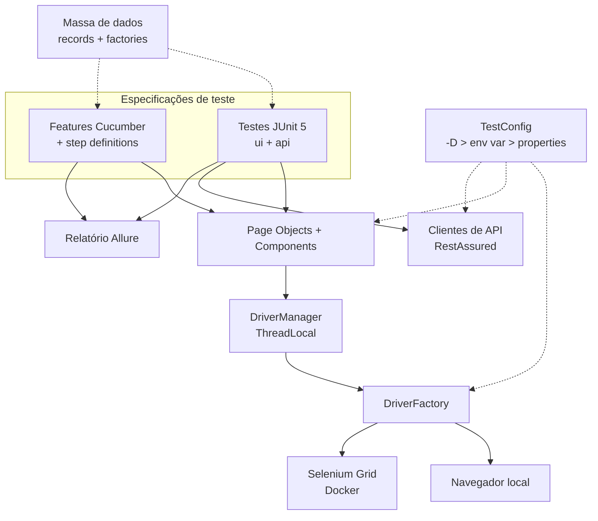

# Selenium Java Test Automation

[English](README.md) | **Português**

[](https://github.com/ricardho/selenium-java-test-automation/actions/workflows/tests.yml)
[](https://ricardho.github.io/selenium-java-test-automation/)


Framework de automação de testes cobrindo **UI web**, **API REST** e cenários **BDD**, construído com
as ferramentas mais usadas no mercado e as boas práticas atuais de arquitetura de testes.

**Relatório de testes online:** https://ricardho.github.io/selenium-java-test-automation/

## Sistemas testados

| Camada | Aplicação |
|---|---|
| UI web | [Swag Labs](https://www.saucedemo.com), um e-commerce de demonstração |
| API REST | [Restful Booker](https://restful-booker.herokuapp.com/apidoc/index.html), uma API de reservas de demonstração |

## Stack

| Finalidade | Ferramenta |
|---|---|
| Linguagem / build | Java 21, Maven |
| Automação de UI | Selenium WebDriver 4 (Selenium Manager, sem drivers manuais) |
| Executor de testes | JUnit 5 (tags, testes parametrizados, execução paralela) |
| BDD | Cucumber 7 + Gherkin, PicoContainer para injeção de dependência |
| Testes de API | RestAssured + validação de JSON Schema |
| Asserções | AssertJ (incluindo soft assertions) |
| Massa de dados | Datafaker |
| Relatórios | Allure (com screenshots, código-fonte da página e tráfego HTTP anexados) |
| Evidências | Screenshots configuráveis por passo + evidência em PDF por teste (OpenPDF) |
| Infraestrutura | Selenium Grid com Docker Compose |
| CI/CD | GitHub Actions, relatório publicado no GitHub Pages |

## Arquitetura



```
src/test/java/com/automation
├── config/        TestConfig: ponto único de leitura das configurações (system prop → env var → arquivo → padrão)
├── driver/        DriverFactory (local/Grid, Chrome/Firefox/Edge) + DriverManager (ThreadLocal)
├── pages/         Page Objects com API fluente
│   └── components/  Partes reutilizáveis da UI (header, badge do carrinho, menu)
├── data/          Records (User, Customer), enums (Product, SortOption) e factories de dados
├── api/           BookingClient + modelos da API
├── support/       Extensão JUnit do ciclo de vida do navegador, helpers
│   └── evidence/    Modos de evidência, gravador por teste, gerador de PDF, captura de passos e HTTP
├── tests/ui/      Testes de UI (JUnit 5)
├── tests/api/     Testes de API (JUnit 5)
└── bdd/           Runner do Cucumber, hooks, estado compartilhado dos cenários e step definitions
src/test/resources
├── features/      Cenários em Gherkin
├── schemas/       JSON schemas para validação de contrato
└── config.properties, junit-platform.properties
```

## Decisões de design

- **Page Object Model com API fluente.** Cada ação retorna a próxima página
  (`login.loginAs(user).addToCart(p).goToCart().checkout()`), então os testes se leem como a jornada do usuário.
  As asserções ficam apenas nos testes e steps, nunca nos page objects.
- **As páginas verificam se foram carregadas.** Cada página espera pelo próprio título ao ser criada, então uma
  navegação errada falha na hora com uma mensagem clara.
- **Somente esperas explícitas.** Todas as interações passam por `WebDriverWait` em `BaseComponent`.
  Sem `Thread.sleep`, sem esperas implícitas.
- **Localizadores estáveis.** Atributos `data-test` primeiro, depois ids. Nada de XPath absoluto.
- **Testes independentes.** Cada teste ou cenário recebe um navegador novo e cria os próprios dados,
  então os testes podem rodar em qualquer ordem e em paralelo.
- **Drivers thread-safe.** WebDriver em `ThreadLocal` permite execução paralela tanto no JUnit quanto no Cucumber.
- **Configuração externalizada.** URLs, navegador, timeouts e credenciais vêm de system properties
  ou variáveis de ambiente, com padrões sensatos. Nada específico de ambiente fica fixo no código.
- **Massa de dados gerada.** O Datafaker cria clientes e reservas únicos, evitando colisões.
- **Evidências de teste configuráveis.** De screenshots apenas em falhas até um screenshot por passo, além de
  um documento PDF de evidência por teste, pronto para auditoria ou homologação (veja [Evidências de teste](#evidências-de-teste)).
- **Camada de API atrás de um cliente.** Os testes nunca montam chamadas HTTP cruas, e as respostas são validadas contra JSON schemas.
- **Sem relatórios duplicados.** JUnit e Cucumber rodam em execuções separadas do Surefire, cada uma com seu adaptador do Allure.

## Cobertura de testes

| Área | Cenários |
|---|---|
| Login | login válido, usuário bloqueado, senha errada, campos obrigatórios, logout |
| Inventário | ordenação por preço e nome, badge do carrinho ao adicionar/remover |
| Checkout | compra completa, cálculo do total e do imposto, campos obrigatórios do cliente |
| API de reservas | criar, consultar com validação de schema, atualizar, excluir, token inválido, credenciais inválidas |
| BDD | jornadas de login e checkout escritas em Gherkin |

Tags: `ui`, `api`, `smoke`, `bdd`.

## Executando os testes

**Pré-requisitos:** JDK 21+, Maven 3.9+, Chrome e/ou Firefox. O Docker só é necessário para o Grid.

**Primeira execução:** crie o arquivo local de segredos a partir do modelo e preencha os valores
(onde encontrar cada um está descrito no próprio arquivo):

```bash
cp .env.example .env      # Windows: copy .env.example .env
```

```bash
# Tudo (JUnit + Cucumber)
mvn test

# Só os testes JUnit, ou só o Cucumber
mvn test -DskipBdd
mvn test -DskipJunit

# Por tag
mvn test -DskipBdd -Dgroups=smoke
mvn test -DskipBdd -Dgroups=api
mvn test -DskipJunit -Dcucumber.filter.tags="@smoke"

# Uma única classe
mvn test -DskipBdd -Dtest=CheckoutTest

# Outros navegadores, modo headless
mvn test -Dbrowser=firefox -Dheadless=true
```

> **Windows PowerShell:** coloque entre aspas os argumentos que têm pontos,
> por exemplo `mvn test "-Dmaven.test.failure.ignore=true"`, senão o PowerShell os divide.

> Se a execução do JUnit falhar, o Maven para antes de rodar o Cucumber.
> Adicione `-Dmaven.test.failure.ignore=true` para rodar os dois e analisar todas as falhas no relatório.

### Selenium Grid (Docker)

```bash
docker compose up -d
mvn test -Dgrid.url=http://localhost:4444 -Dbrowser=firefox
docker compose down
```

Console do Grid: http://localhost:4444/ui

### Configuração

Cada configuração é resolvida nesta ordem:
`-Dchave=valor` → variável de ambiente → `.env` local → `config.properties` → padrão.
Veja o [.env.example](.env.example) para todas as variáveis.

| Propriedade | Variável de ambiente | Padrão |
|---|---|---|
| `base.url` | `BASE_URL` | https://www.saucedemo.com |
| `api.base.url` | `API_BASE_URL` | https://restful-booker.herokuapp.com |
| `browser` | `BROWSER` | chrome |
| `headless` | `HEADLESS` | false |
| `timeout.seconds` | `TIMEOUT_SECONDS` | 10 |
| `grid.url` | `GRID_URL` | (vazio: roda localmente) |
| `evidence.mode` | `EVIDENCE_MODE` | failure (`failure`, `always`, `steps`) |
| `evidence.pdf` | `EVIDENCE_PDF` | true |
| `sauce.password` | `SAUCE_PASSWORD` | **segredo**, sem padrão |
| `api.username` / `api.password` | `API_USERNAME` / `API_PASSWORD` | **segredo**, sem padrão |

## Gestão de segredos

Credenciais nunca ficam em arquivos versionados, seguindo a abordagem [12-Factor](https://12factor.net/config):
o código só lê variáveis de ambiente e não se importa com a origem delas.

| Ambiente | Origem dos segredos |
|---|---|
| Máquina do desenvolvedor | Arquivo `.env`, ignorado pelo git, criado a partir do `.env.example` |
| CI (GitHub Actions) | Repository secrets, expostos aos jobs de teste como variáveis de ambiente e mascarados nos logs |
| Organizações maiores (próximo passo) | Um cofre de segredos como HashiCorp Vault, AWS Secrets Manager ou Azure Key Vault, injetado pelo pipeline |

Proteções adicionais:
- O **Gitleaks** varre todo o histórico do git a cada push e falha o pipeline se algum segredo for commitado.
- Os arquivos feature usam o placeholder `${SAUCE_PASSWORD}`, resolvido em tempo de execução, então nenhuma senha é escrita no Gherkin.
- `User.toString()` oculta as senhas, então elas nunca aparecem em logs nem no relatório Allure.
- As requisições de autenticação não passam pelo log cru do AllureRestAssured: senhas e tokens aparecem mascarados
  como `***` tanto no relatório Allure quanto na evidência em PDF.
- Um segredo ausente falha imediatamente, com uma mensagem explicando como fornecê-lo.

> As credenciais dos dois sites de demonstração são públicas. Mesmo assim elas são tratadas como segredos de propósito,
> para demonstrar a abordagem usada em projetos reais.

## Evidências de teste

Muitas equipes (bancos, seguradoras, consultorias) precisam de evidência também dos testes **aprovados**, para auditoria
ou homologação. A quantidade de evidência é configurável:

| `evidence.mode` | O que é capturado | Uso típico |
|---|---|---|
| `failure` (padrão) | Screenshot, URL e código-fonte da página quando um teste falha | Desenvolvimento local: o mais rápido |
| `always` | Mais um screenshot final de cada teste | Pipeline de CI |
| `steps` | Mais um screenshot após cada passo | Auditoria / homologação |

```bash
mvn test "-Devidence.mode=steps"
```

Com `evidence.pdf=true` (padrão), cada teste também gera um **documento PDF de evidência** em
`target/evidence/`, com nome no formato `PASSED_CheckoutTest_Should_complete_a_purchase_<timestamp>.pdf`:

- Cabeçalho: teste, suíte, status, horário de início, duração, aplicação ou API, navegador, ambiente de execução
- Resumo da falha (testes que falharam)
- Passos numerados com seus screenshots; nos testes de API, cada requisição e resposta
  com senhas e tokens mascarados

No modo `failure`, só os testes que falharam geram PDF. Todo PDF também é anexado ao relatório Allure,
e o CI os publica como o artefato de build `test-evidence-pdf`.

Como funciona: os métodos `@Step` dos page objects e os steps do Cucumber são ambos steps do Allure, então um único
`StepLifecycleListener` do Allure tira os screenshots por passo tanto para o JUnit quanto para o Cucumber. Um
filtro do RestAssured registra as trocas HTTP, e um gravador thread-local mantém as evidências isoladas
quando os testes rodam em paralelo.

## Relatórios

```bash
mvn allure:serve     # gera e abre o relatório
mvn allure:report    # gera em target/site/allure-maven-plugin
```

O Cucumber também gera `target/cucumber-report.html`.

## CI/CD

O [workflow do GitHub Actions](.github/workflows/tests.yml) roda a cada push e pull request,
e em um agendamento nos dias úteis:

1. Varredura de segredos com Gitleaks (os jobs de teste só começam se ela passar)
2. Suítes JUnit (UI + API) e Cucumber no Chrome headless
3. Smoke tests de UI cross-browser no Firefox
4. Na `main`, o relatório Allure é publicado no GitHub Pages

Configuração do repositório:
- **Settings → Secrets and variables → Actions → New repository secret**:
  crie `SAUCE_PASSWORD`, `API_USERNAME` e `API_PASSWORD`.
- **Settings → Pages → Source: GitHub Actions**, para publicar o relatório.

## Roadmap

- [ ] Interceptação de rede e captura de logs do console com WebDriver BiDi
- [ ] Testes de regressão visual
- [ ] Verificações de acessibilidade (axe-core)
- [ ] Histórico e tendências do Allure entre execuções
